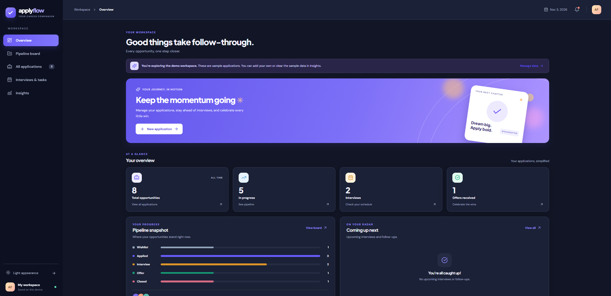
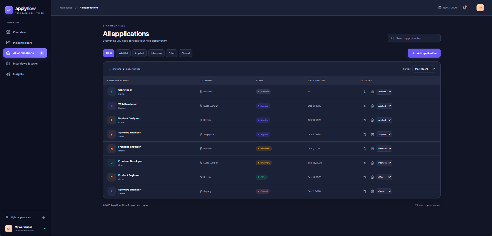

# ApplyFlow — Your career, organized

A responsive job application tracker that helps job seekers organize opportunities, monitor application stages, and manage interviews and follow-ups in one place.

## Problem Statement — What problem does it solve?

When applying for multiple jobs, information becomes scattered across job boards, emails, browser tabs, and spreadsheets. It is easy to forget follow-up dates, lose track of application statuses, or miss interviews.

**ApplyFlow provides one visual workspace** for capturing applications, moving them through recruitment stages, tracking next actions, and reviewing job-search progress. It works directly in the browser without requiring an account.

## Key Features

- Dashboard summarizing applications, reminders, and recent activity
- Drag-and-drop Kanban board: **Wishlist → Applied → Interview → Offer → Closed**
- Add, edit, and remove applications with company, role, dates, location, recruiter, URL, and notes
- Search, filter, sort, and change stages in the application table
- Interview and follow-up tracking with upcoming/overdue indicators
- Insights showing a seven-day chart, stage breakdown, and response rate
- CSV export for backups
- Responsive interface with light and dark modes
- Browser LocalStorage persistence, with fictional demo records

## Verified Tech Stack

| Component | Technology |
| --- | --- |
| Frontend | React 18, JavaScript, CSS |
| Tooling | Vite 6, `@vitejs/plugin-react` |
| Icons | `lucide-react` |
| Storage | Browser LocalStorage |
| Deployment | Static GitHub Pages build in `docs/` |

**Architecture:** Frontend-only; no backend, cloud database, user authentication, or API keys are required. Versions were verified from the checked-in `package.json` and `vite.config.js`.

## Run Locally

### Prerequisites

- Node.js 18+ (Node.js 20 or 22 recommended)
- npm

### 1. Clone the repository

```bash
git clone https://github.com/amirullqayyumm/ApplyFlow-Job-Tracker.git
cd ApplyFlow-Job-Tracker
```

### 2. Install dependencies

```bash
npm install
```

### 3. Run the development server

```bash
npm run dev
```

Open the URL shown in the terminal (usually `http://localhost:5173`). No `.env` file or database setup is needed.

## Example Output / Walkthrough

1. **Dashboard:** See application counts and approaching follow-up dates.
2. **New application:** Create an entry for a company and job title.
3. **Kanban:** Move its card from *Wishlist* to *Applied* after submitting.
4. **Interview:** Update the status and record upcoming interview/follow-up details.
5. **Insights:** Review the pipeline and export a CSV backup.

These are **example interactions**, not claims of actual job applications.

### Dashboard — Overview

The main workspace summarizes the job-search journey using four metric cards: **Total Opportunities, In Progress, Interviews, and Offers Received**. The sample data shown includes **8 opportunities, 5 in progress, 2 interviews, and 1 offer**, alongside a pipeline snapshot and follow-up area.



### All Applications — Tracking and Filtering

The applications view lists company, position, location, stage, and date applied, with controls for search, stage filtering, sorting, editing, deleting, and quick stage changes.



### More views

The navigation also includes a **Pipeline Board**, **Interviews & Tasks**, and **Insights**. Add screenshots of these screens to `screenshots/` when available, then reference them here.

> All companies, roles, dates, and stage counts in the screenshots belong to the app's fictional demonstration workspace.

## Production Build and GitHub Pages

```bash
npm run build
```

Vite's checked-in configuration generates the site into the **`docs/`** folder with relative asset paths (`base: './'`). To preview the production build:

```bash
npm run preview
```

To publish:

1. Run `npm run build` and commit/push the updated `docs/` folder to the `main` branch.
2. Open **GitHub repository → Settings → Pages**.
3. Under **Build and deployment**, choose **Deploy from a branch**.
4. Select **main** and **/docs**, then save.
5. Open the live URL that GitHub displays in Pages settings.

For later updates:

```bash
npm run build
git add .
git commit -m "Update ApplyFlow"
git push
```

## Project Structure

```text
ApplyFlow-Job-Tracker/
├── src/
│   ├── App.jsx           # Main app and workflow UI
│   ├── App.css           # Styles
│   ├── data.js           # Data utilities and examples
│   ├── utils.js          # Helper functions
│   └── main.jsx          # React entry point
├── screenshots/          # Real application screenshots
├── docs/                 # GitHub Pages production build
├── index.html
├── vite.config.js
├── package.json
└── README.md
```

## Demo Data and Privacy

The starter records are **fictional** and do not indicate that real applications were submitted. Use **Insights → Clear all** to begin with a clean workspace. Data stays in the current browser's LocalStorage and does **not** sync across devices. Export a CSV backup before clearing data or changing browsers. Avoid storing confidential information about recruiters or employers.

## Skills Demonstrated

React state management, component-based UI development, drag-and-drop interactions, browser-based persistence, filters and analytics, CSV export, and static deployment with Vite.

## Developer

Developed by **Amirul Qayyum** — [GitHub](https://github.com/amirullqayyumm).
